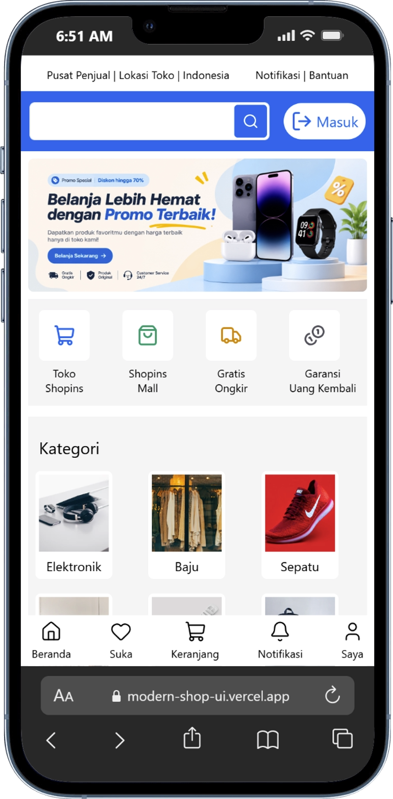

# 🛒 Shop app

An online shopping application interface that adapts to the screen sizes of various devices.

---

### 🛠️ Tech Stack

* **Primary Programming Language:** TypeScript
* **CSS Framework:** Tailwind CSS
* **Runtime & Package Manager:** Bun

---

### 📱 Mobile View

  
  
  
  

---

### 💻 Desktop View

  
    
  
    
  
  
  

